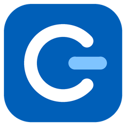

<p align="center"></p>

# ClassBoard

**Tableau blanc interactif libre, gratuit et moderne pour les établissements scolaires.**
Pensé pour remplacer Interwrite Workspace sur les TBI et vidéoprojecteurs interactifs
(Epson et autres), sous Windows 10 et 11.

ClassBoard est un *fork* d'[OpenBoard](https://github.com/OpenBoard-org/OpenBoard) 1.7.7 :
il conserve son moteur d'écriture, ses documents, ses instruments de géométrie et
l'annotation du bureau, et ajoute une interface modernisée, un profil par discipline
et des outils de classe.

> 🇫🇷 Interface en français par défaut · hors connexion · sans compte · sans abonnement ·
> sans télémétrie · sans droits administrateur · licence GPL-3.0

## Ce que ClassBoard apporte

| | |
|---|---|
| **Assistant de premier lancement** | L'enseignant choisit sa ou ses disciplines (15 au choix). ClassBoard propose les outils et favoris adaptés, sans rien cloisonner. |
| **Barre de favoris** | Une barre verticale à gauche du tableau : règle, compas, minuteur, tirage au sort… selon les disciplines. Personnalisable. |
| **Interface modernisée** | Style Fluent (Windows 11), icônes au trait, libellés sous les outils, gros boutons (100/125/150 %), thème clair ou sombre. |
| **Outils de classe** | Nouveaux **Minuteur** et **Tirage au sort** (élève sans remise, groupes, dés), hors connexion. |
| **Écriture scolaire** | Fonds **Seyès** activés, polices **Marelle** (cursive officielle de l'Éducation nationale) et **Écolier**. |
| **Déploiement** | Installateur `.exe` (sans droits administrateur), `.msi` pour déploiement silencieux (Kwartz, GPO), version portable `.zip`. |
| **Vie privée** | Aucune requête réseau automatique : la recherche de mises à jour vers les serveurs d'OpenBoard est désactivée. |

Tout ce qu'OpenBoard sait faire reste disponible : stylo, surligneur, gomme, formes et
reconnaissance de formes, texte, images, annuler/rétablir, pointeur laser, annotation du
bureau Windows, import et annotation PDF, captures, multipage, fonds, audio/vidéo,
masque/rideau/projecteur, instruments (règle, équerre, rapporteur, compas, repère),
sauvegarde automatique, export PDF, impression, documents `.ubz` d'OpenBoard.

## Télécharger

Les versions publiées sont sur la page [Releases](https://github.com/rachid598/ClassBoard/releases).
Chaque compilation de la branche de développement produit aussi des artefacts dans
[GitHub Actions](https://github.com/rachid598/ClassBoard/actions).

| Fichier | Pour qui |
|---|---|
| `ClassBoard-Setup-x64.exe` | Installation sur un poste. Sans droits administrateur par défaut. |
| `ClassBoard-Setup-x64.msi` | Déploiement silencieux sur un parc (Kwartz, GPO). |
| `ClassBoard-Portable-x64.zip` | Clé USB, poste verrouillé : décompresser et lancer. |
| `SHA256SUMS.txt` | Sommes de contrôle. |

Installation silencieuse : voir [docs/utilisateur/deploiement.md](docs/utilisateur/deploiement.md).

> ⚠️ **Les exécutables ne sont pas signés** (pas de certificat de signature de code).
> Windows SmartScreen peut afficher un avertissement : « Informations complémentaires »
> puis « Exécuter quand même ». Vérifiez la somme SHA-256 en cas de doute.

## Documentation

- [Guide de l'enseignant](docs/utilisateur/README.md)
- [Déploiement en établissement (Kwartz, MSI, portable)](docs/utilisateur/deploiement.md)
- [Documentation technique](docs/technique/README.md) — compilation, CI, modules
- [ARCHITECTURE.md](ARCHITECTURE.md) — choix techniques et audit des projets de référence
- [ROADMAP.md](ROADMAP.md) · [CHANGELOG.md](CHANGELOG.md) · [CONTRIBUTING.md](CONTRIBUTING.md)
- [HANDOVER.md](HANDOVER.md) — état du projet pour reprendre le développement

## Compiler

Aucune compilation locale n'est nécessaire : GitHub Actions compile et empaquette
ClassBoard pour Windows à chaque modification. Pour compiler soi-même :

- **Windows** (Qt 6.8 MSVC 2022) : `scripts/windows/build.ps1`, puis `deploy.ps1` et `package.ps1`
- **Linux** (contrôle et tests) :
  ```bash
  cmake -S . -B build -G Ninja -DQT_VERSION=6 -DCLASSBOARD_BUILD_TESTS=ON
  cmake --build build && ctest --test-dir build
  ```

Détails : [docs/technique/README.md](docs/technique/README.md).

## Licence et crédits

ClassBoard est distribué sous **GNU GPL version 3** (voir [LICENSE](LICENSE)), avec
l'exception de liaison OpenSSL héritée d'OpenBoard (voir [COPYRIGHT](COPYRIGHT)).

- Basé sur **OpenBoard** © Open Education Foundation et contributeurs, lui-même issu
  d'**Open-Sankoré** (© GIP ENA) et d'**Uniboard** (© Mnemis SA).
- Polices **Marelle** © Ministère de l'Éducation nationale (OFL-1.1) et **Écolier Court**
  © Jean-Marie Douteau (OFL-1.1), reprises d'[Open-Sankoré Community Edition](https://github.com/davidguyomarch/Sankore).
- Icônes, assistant, profil, widgets Minuteur et Tirage au sort : contributeurs ClassBoard (GPL-3.0).

ClassBoard n'est ni affilié ni approuvé par l'Open Education Foundation ou Epson.
